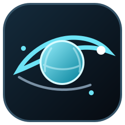
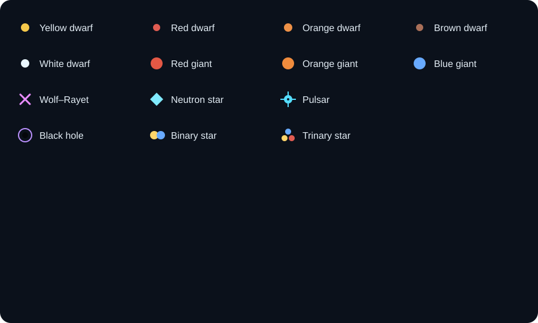

# Planet Database

A lightweight desktop app for mapping named star systems in a rotatable 3D view. The camera uses an orthographic projection, with each system positioned by independent **X, Y, and Z coordinates in light-years**.

**Current version: 0.11.1.** The app displays its version in the header. Versions follow Semantic Versioning: feature releases advance the minor number, and fixes advance the patch number. The version is maintained in `main.py` and updated as the app changes.

## Run

Requires Python 3.10 or newer and the CustomTkinter dependency:

```powershell
python -m pip install -r requirements.txt
python main.py
```

The window opens maximized after initialization. The header reads “Planetary Database”; the SVG icon design and converted Windows ICO are in the [icons](./icons/) folder. CustomTkinter follows the Windows system light/dark theme, and its native title bar stays enabled so Windows can draw the standard caption and controls.

## Build a Windows application folder

Install the app requirements and Nuitka in the Python environment you want to use for the build. Nuitka also needs a supported C compiler; on Windows, Visual Studio 2022 C++ Build Tools is a supported option.

```powershell
python -m pip install -r requirements.txt
python -m pip install nuitka
.\build-nuitka.ps1
```

The script creates a standalone, windowed application in `%USERPROFILE%\Downloads\Planet Database`. It includes the executable, Nuitka runtime dependencies, and the app ICO under `icons`; it does not copy the repository, tests, archive, or SVGs. If that output folder already exists, rename it or choose another destination:

```powershell
.\build-nuitka.ps1 -OutputDirectory "$env:USERPROFILE\Downloads\Planet Database Test"
```

The script also compiles `Setup.iss` into an installer in Downloads, using Inno Setup (`ISCC.exe`). It auto-detects Inno Setup 7 at `D:\Inno Setup 7` and standard Inno Setup 7/6 install locations. If needed, pass `-InnoSetupCompiler` with the full compiler path. Use `-SkipInstaller` to build only the standalone folder. A custom `-OutputDirectory` is used as the installer’s source folder too.

The standalone folder can be moved as a unit. The app’s database and settings continue to live in the user’s AppData directory.

## Map and systems

- **The base grid interval is 1,000 light-years.** Zooming in uses round-number placement intervals down to 1 light-year at maximum zoom, while visible grid lines are spaced at every other placement subdivision to keep the view less crowded. Placement still snaps to the finer subdivisions. Vertical guide dash lengths track the active placement interval. Coordinates can be entered to five decimal places. The map is general-purpose and is not tied to any particular galaxy.
- The ground grid is drawn for the visible area and continues as you pan, zoom, and rotate the camera. The default camera angle preserves the familiar isometric view.
- Right-click a grid intersection to choose X and Y; enter Z separately. Right-clicking again while adding a system repositions it without changing Z. The placement preview appears only while adding a star system. For nonzero Z, its guide runs from the ground-grid location up to the star marker and updates as coordinates change.
- Map labels stay hidden until you hover over a marker. Left-click a saved marker to show its saved notes and four closest other systems by straight-line 3D distance; right-click it to edit. Click an empty map area to close the panel. Right-click a grid intersection to add a star.
- Drag the vertical dividers between the system catalog, editor, and map to resize each panel horizontally.
- Panel widths are saved after resizing and when the app closes in `%APPDATA%\Planet Database\app-settings.json`, then restored when the app starts.
- Select a stellar class when creating or editing a system. The map uses small shape-and-color markers for yellow, orange, red, brown, and white dwarfs; red, orange, and blue giants; Wolf–Rayet stars; neutron stars; pulsars; black holes; and binary or trinary star systems. Older records without a star type display as yellow dwarfs; records using the retired “White star” type are now treated as white dwarfs.
- Left-drag to pan and middle-drag to rotate the 3D camera. Rotation orbits around the ground-plane point beneath the star nearest the center of the view; with no stars, it uses the ground point at the view center. Camera elevation stays between 8° and 88° to keep the ground plane usable. Scroll to zoom around the ground point under the cursor.
- The maximum zoom level has been increased another 8×, to 32768 spacing; the grid continues subdividing to match.
- System catalog text is centered. Left-clicking a catalog entry opens a read-only panel showing that system's notes and four closest other systems. Right-clicking an entry opens the full system editor, including editable notes; use **Save system** to save changes.
- Scrolling over a nested panel, such as the stellar-type list, scrolls that panel rather than also scrolling its containing editor.
- On startup, the view automatically frames saved systems instead of assuming they are near the origin. Selecting or saving a system recenters and zooms in on it.
- Each system gets a unique, persistent ID (shown in its editor with a copy button) that can be used to attach planet, moon, or other records later.
- A grouped action bar keeps star actions, session history, and project import/export in separate, labeled groups. Use **Save system** or **Ctrl+S** to save. Star types are selected in the editor itself; there are no popout menus. The system-aware app theme uses neutral grays in both light and dark modes.
- Left-click a star in the map or catalog to view its saved notes and nearest systems in a read-only panel; right-click a star to edit it. On the map, right-click an empty grid location to add a star, and left-drag to pan.
- Keyboard shortcuts: **Ctrl+S** saves the current system, **Ctrl+Z** undoes a saved change, and **Ctrl+Y** redoes it. Undo/redo ask for confirmation, update the AppData database, and support up to 100 saved changes during the current session only; history clears when the app closes.
- **Export** creates a compressed `.planetdata` project archive containing `planet-systems.json`; **Import** loads that format after confirmation, replacing the current database. Installed `.planetdata` files use the matching project icon, and opening one launches the app's import flow. An import can be undone with **Ctrl+Z** during the current session.

The database is stored automatically at `%APPDATA%\Planet Database\planet-systems.json`. Previous project-folder data is imported there on first launch when the old folder setting and database are present; older grid coordinates are converted to light-years.

The previous C++/Qt prototype is preserved in [archive/PlanetDatabase-Cpp-2026-11-03.zip](archive/PlanetDatabase-Cpp-2026-11-03.zip).

The `.planetdata` file icon design is available as [SVG](./icons/planetdata-file-icon.svg) and [Windows ICO](./icons/planetdata-file-icon.ico) for a future file-association setup.

### Icons

App icon: 

Stellar marker styles available in the type selector:



## Tests

```powershell
python -m unittest discover -s tests -v
```
